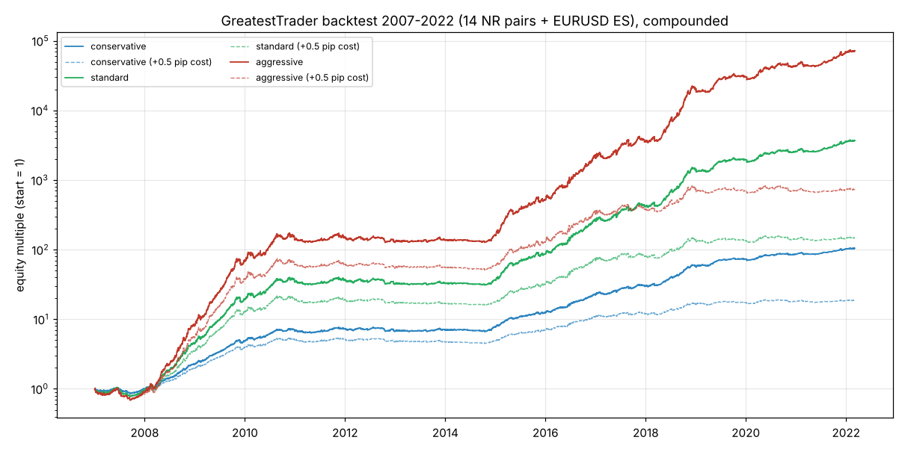
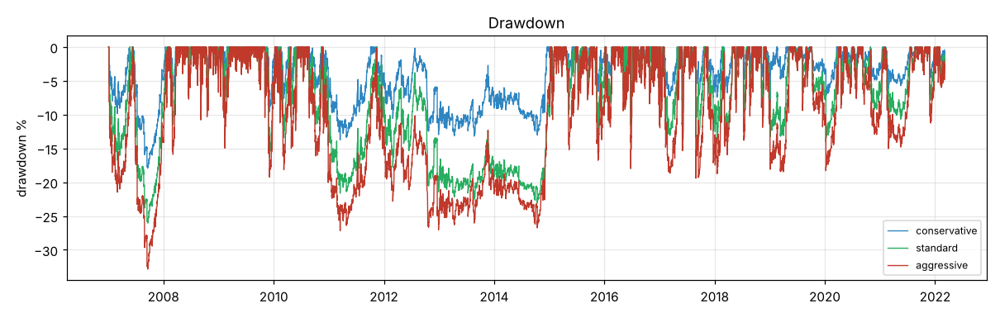
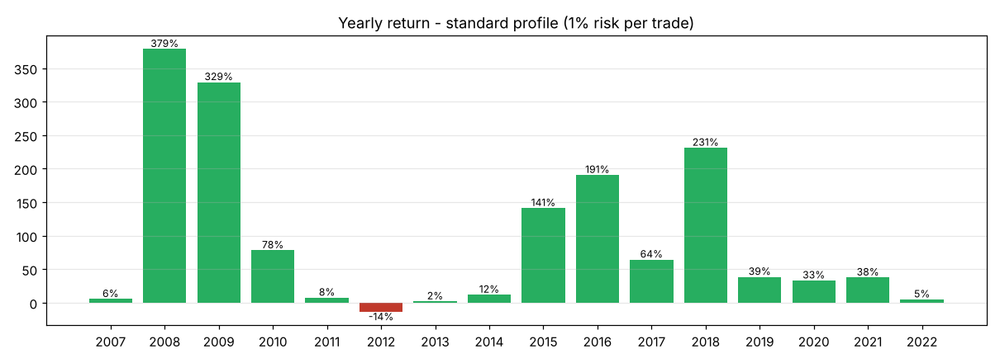
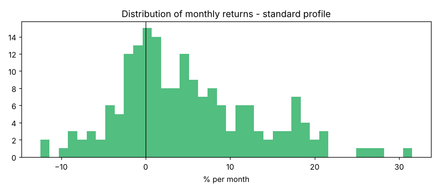

# GreatestTrader バックテスト報告書

バージョン 1.0.0 ／ 検証期間 2007 年 1 月 〜 2022 年 3 月（約 15 年）

---

## 1. 結論

| 項目 | 結果 |
|---|---|
| 月利 5% 目標 | **aggressive（1 取引 1.5%）で達成。** 月平均は 2007〜2022 年 7.06%、2011〜2022 年 5.18%、2017〜2022 年 6.39% |
| リスク | aggressive の最大ドローダウン −32.9%、最悪月 −14.6%、プラスの月 68% |
| 安定性 | シャープレシオ（月次を年率換算）約 2.0。テスト期間（2017〜2022 年）でも 1.9〜2.2 を維持 |
| 弱点 | ① コストに敏感（+0.5 pips で月利が約 4 割低下）② 収益が変動の大きい年に偏る（2011〜2014 年はほぼ横ばい） |

**本報告書の数値は過去データによるシミュレーションで、将来の成績を保証するものではありません。**

---

## 2. 検証条件

| 項目 | 条件 |
|---|---|
| データ | 2000 年〜2019 年 6 月：1 分足（Bid）から作成した 15 分足。2019 年 7 月〜2022 年 3 月：15 分足（7 通貨ペア） |
| 対象 | NR 14 ペア + ES（EURUSD）。**2019 年 7 月以降は NR 7 ペア（EURJPY, GBPJPY, USDJPY, GBPUSD, EURGBP, USDCHF, EURUSD）のみ** |
| 約定 | シグナル足の次の足の始値で成行。足の中で SL と TP の両方に届いた場合は SL を優先（保守的）。窓開けで SL を越えた場合は始値で約定 |
| コスト（往復、手数料込み） | EURUSD 1.0／USDJPY 1.1／GBPUSD・EURGBP 1.5／USDCHF 1.6／EURJPY 1.7／AUDCAD 2.0／EURCAD・EURAUD 2.2／CHFJPY 2.4／GBPJPY・GBPCHF 2.6／GBPCAD・GBPAUD 3.0 pips |
| スリッページ | 上記に加えて全取引に NR +0.5 pips、ES +0.3 pips |
| スワップ | なし（すべての取引が日付変更前に決済されるため） |
| 資金管理 | 固定比率の複利運用。DD 連動の縮小、同時保有 10、同一通貨 4、日次 −5% 停止を含む |
| 使用プログラム | 同梱の Python バックテスター（`python main.py backtest`。本稼働エンジンと同じ戦略・リスク管理クラス） |

---

## 3. プロファイル別の成績

### 3.1 基本コスト

| プロファイル | 期間 | 月利 平均 | 月利 中央値 | 年率（CAGR） | 最大 DD | 最悪月 | 最良月 | プラス月 | シャープ |
|---|---|---|---|---|---|---|---|---|---|
| conservative 0.5% | 2007〜2022 | 2.71% | 2.24% | 36.0% | −17.9% | −8.7% | +15.0% | 70% | 2.19 |
| | 2011〜2022 | 2.11% | 1.63% | 27.7% | −13.2% | −8.7% | +15.0% | 68% | 1.91 |
| | 2017〜2022 | 2.54% | 1.91% | 34.6% | −8.0% | −4.8% | +15.0% | 75% | 2.22 |
| standard 1.0% | 2007〜2022 | 4.99% | 3.60% | 72.1% | −26.1% | −12.5% | +31.5% | 68% | 2.11 |
| | 2011〜2022 | 3.76% | 2.22% | 52.1% | −23.1% | −12.2% | +31.5% | 65% | 1.84 |
| | 2017〜2022 | 4.62% | 3.20% | 67.9% | −14.0% | −8.8% | +31.5% | 71% | 2.03 |
| **aggressive 1.5%** | **2007〜2022** | **7.06%** | **4.32%** | **109.4%** | **−32.9%** | **−14.6%** | **+49.5%** | **68%** | **2.05** |
| | **2011〜2022** | **5.18%** | **2.68%** | **75.1%** | **−26.9%** | **−13.4%** | **+49.5%** | **65%** | **1.79** |
| | **2017〜2022** | **6.39%** | **3.78%** | **99.3%** | **−19.4%** | **−13.4%** | **+49.5%** | **71%** | **1.92** |

### 3.2 コスト感応度（全取引のコストを +0.5 pips 悪化させた場合）

| プロファイル | 2007〜2022 月平均 | 2011〜2022 月平均 | 2017〜2022 月平均 | 最大 DD |
|---|---|---|---|---|
| conservative | 1.72% | 1.02% | 0.92% | −18.0% |
| standard | 3.07% | 1.66% | 1.35% | −26.4% |
| aggressive | 4.21% | 2.07% | 1.58% | −33.3% |

→ **口座のコストが成否を決めます。** 取扱説明書 3 章の条件を満たす口座を使ってください。

---

## 4. 年別・月別リターン

### 4.1 プロファイル別の年間リターン

| 年 | conservative | standard | aggressive |
|---|---|---|---|
| 2007 | +5.5% | +5.5% | +3.6% |
| 2008 | +127.0% | +378.6% | +823.7% |
| 2009 | +116.4% | +329.2% | +738.7% |
| 2010 | +39.7% | +78.2% | +104.0% |
| 2011 | +7.6% | +7.6% | +8.6% |
| 2012 | -8.6% | -14.1% | -15.9% |
| 2013 | +3.8% | +2.1% | +6.1% |
| 2014 | +11.3% | +12.0% | +18.3% |
| 2015 | +61.7% | +141.3% | +230.6% |
| 2016 | +80.4% | +190.7% | +287.7% |
| 2017 | +32.9% | +64.4% | +75.4% |
| 2018 | +92.6% | +231.3% | +449.0% |
| 2019 | +25.4% | +38.6% | +51.1% |
| 2020 | +18.7% | +33.3% | +46.5% |
| 2021 | +18.4% | +37.7% | +54.8% |
| 2022 | +2.8% | +5.0% | +6.7% |

（2022 年は 3 月まで）

### 4.2 standard（1.0%）の月次リターン（%）

| 年 | 1月 | 2月 | 3月 | 4月 | 5月 | 6月 | 7月 | 8月 | 9月 | 10月 | 11月 | 12月 | 年間 |
|---|---|---|---|---|---|---|---|---|---|---|---|---|---|
| 2007 |  | -3.4 | +2.5 | +4.0 | +7.0 | -6.6 | -7.7 | -4.9 | -1.5 | +4.2 | +5.1 | +8.2 | **+5.5** |
| 2008 | +11.2 | -1.4 | +15.7 | +25.3 | +16.3 | +5.9 | +11.5 | +27.1 | +13.7 | +16.6 | +21.4 | +7.2 | **+378.6** |
| 2009 | +19.3 | +4.1 | +15.9 | +18.0 | +14.6 | +11.9 | +17.7 | +18.1 | +18.0 | +27.8 | -12.5 | +7.4 | **+329.2** |
| 2010 | +17.8 | -3.4 | +0.5 | +4.5 | +4.1 | +19.4 | +17.0 | +9.4 | -4.3 | -0.6 | +8.9 | -9.6 | **+78.2** |
| 2011 | -2.2 | -3.5 | -1.6 | -1.7 | +1.6 | +2.8 | +4.7 | -0.1 | +5.4 | +6.3 | -2.1 | -1.5 | **+7.6** |
| 2012 | -4.3 | -6.6 | +8.8 | -0.5 | -1.4 | +0.3 | +5.8 | -0.8 | -0.7 | -12.2 | +6.9 | -8.3 | **-14.1** |
| 2013 | +2.2 | -0.2 | -0.1 | -0.4 | -1.5 | +0.7 | +1.7 | -1.6 | +0.8 | +3.7 | -2.1 | -1.1 | **+2.1** |
| 2014 | +1.3 | -0.7 | +0.1 | -0.2 | +0.3 | -2.2 | -0.6 | +0.2 | -1.8 | +0.8 | +1.4 | +13.5 | **+12.0** |
| 2015 | +10.7 | +18.0 | +19.4 | +9.6 | +1.6 | +8.0 | +4.2 | +7.3 | +3.8 | +12.7 | -5.3 | +4.0 | **+141.3** |
| 2016 | +5.2 | +8.9 | +12.7 | +8.1 | -0.7 | +18.7 | +12.8 | +10.1 | +5.0 | +13.1 | +9.1 | +9.9 | **+190.7** |
| 2017 | +12.4 | -8.8 | +3.5 | +7.3 | -0.3 | +21.3 | +8.7 | -1.7 | -0.5 | +15.9 | +1.4 | -4.4 | **+64.4** |
| 2018 | -0.1 | +10.9 | -7.6 | +11.0 | +19.9 | +20.5 | +2.9 | +12.6 | +20.9 | +31.5 | +14.3 | -4.1 | **+231.3** |
| 2019 | -3.5 | +0.8 | -0.3 | +8.0 | +18.0 | +6.2 | +4.8 | +2.2 | +4.2 | -3.8 | +1.5 | -3.0 | **+38.6** |
| 2020 | -4.6 | +2.9 | +10.9 | +7.5 | +5.8 | +3.3 | +0.2 | +7.1 | -0.2 | +2.8 | -8.2 | +3.2 | **+33.3** |
| 2021 | +4.8 | -5.9 | +1.5 | +1.1 | -1.2 | +4.1 | +6.1 | +3.2 | +7.5 | +2.3 | +3.5 | +6.1 | **+37.7** |
| 2022 | +5.8 | -1.7 | +1.0 |  |  |  |  |  |  |  |  |  | **+5.0** |

---

## 5. 取引統計（standard、2007〜2022 年）

| 項目 | 値 |
|---|---|
| 取引回数 | 20,337（月 約 112 回） |
| 勝率 | 71.5% |
| 1 取引あたりの平均 R | +0.051 R（R = 損切り幅） |
| プロフィットファクター | 1.31 |
| 決済理由 | TP（移動平均）13,097 ／ ES 時間決済 3,421 ／ SL 2,069 ／ NR 時間切れ 1,750 |
| NR の保有時間（中央値） | 75 分 |

### 5.1 戦略別

| 戦略 | 取引回数 | 勝率 | 平均 R | PF | 単独の月平均 | 単独の最大 DD | シャープ |
|---|---|---|---|---|---|---|---|
| Night Reversion | 16,433 | 76.4% | +0.057 | 1.53 | 4.65% | −25.7% | 2.04 |
| Euro Session | 3,929 | 50.6% | +0.022 | 1.07 | 0.33% | −14.3% | 0.53 |

### 5.2 通貨ペア別（Night Reversion）

| ペア | 取引 | 勝率 | 平均 R | 合計 R |
|---|---|---|---|---|
| GBPCAD | 953 | 80.2% | +0.116 | +110.1 |
| EURCAD | 983 | 78.0% | +0.098 | +96.6 |
| AUDCAD | 1,268 | 79.1% | +0.089 | +113.3 |
| GBPCHF | 995 | 79.0% | +0.087 | +86.3 |
| GBPUSD | 1,160 | 76.4% | +0.067 | +77.4 |
| EURAUD | 1,468 | 78.3% | +0.063 | +92.3 |
| GBPAUD | 1,353 | 77.5% | +0.063 | +85.2 |
| EURGBP | 772 | 74.5% | +0.057 | +43.9 |
| CHFJPY | 1,051 | 75.9% | +0.051 | +53.3 |
| USDCHF | 815 | 76.2% | +0.047 | +38.5 |
| GBPJPY | 1,538 | 75.4% | +0.041 | +62.3 |
| USDJPY | 1,422 | 74.6% | +0.033 | +47.5 |
| EURJPY | 1,566 | 73.7% | +0.015 | +23.1 |
| EURUSD | 1,095 | 72.1% | +0.011 | +12.4 |

全 14 ペアで、期間通算の平均 R がプラスでした。

---

## 6. 過剰最適化への対策と頑健性の確認

### 6.1 期間分割（Night Reversion 14 ペアのポートフォリオ、月次 R ベースのシャープレシオ）

| 期間 | 役割 | シャープ | 月平均（R） |
|---|---|---|---|
| 2000〜2010 年 | 学習（パラメータ探索） | 2.79 | +8.4 R |
| 2011〜2016 年 | 検証（候補の絞り込み） | 1.32 | +3.1 R |
| 2017〜2022 年 | テスト（最終確認・一度だけ評価） | 2.37 | +4.8 R |

### 6.2 パラメータ感度（243 通り）

次の範囲で 243 通りを検証しました：ボリンジャーバンド期間 15・20・30、σ 1.8・2.0・2.3、SL 2・3・4 ATR、保有 8・12・16 本、コストフィルター 1.5・2.0・2.5 倍。

期間 15〜20、SL 3〜4 ATR、保有 12〜16 本、コストフィルター 2.0〜2.5 倍の範囲では、3 期間すべてでシャープがおおむね 1.0 以上の領域がなだらかに広がっていました（期間 30 では低下）。採用値（15 / 1.8 / 3.0 / 12 / 2.0）はこの領域の中にあります。単独のピーク値は採用していません。

### 6.3 設計に使っていない通貨ペアでの確認（同じパラメータ）

| ペア | 学習期 平均 pips | 検証期 | テスト期 |
|---|---|---|---|
| EURNZD | +6.3 | ±0.0 | +2.6 |
| GBPNZD | +9.3 | ±0.0 | +2.4 |
| CADCHF | +4.6 | +1.6 | +1.6 |
| EURCHF | +0.8 | +0.9 | +2.1 |

一方、豪ドル・NZ ドルのドルストレート（AUDUSD・NZDUSD）はマイナスでした（この時間帯が現地の取引時間にあたるため）。そのため対象から外しています。

### 6.4 不採用とした戦略（参考）

| 戦略 | 結果 |
|---|---|
| 日足トレンドフォロー（主要 5 ペア） | シャープ 0.1〜0.4。コストとスワップを考えると不採用 |
| ロンドンブレイクアウト | 全ペアでテスト期間がマイナス |
| 他の時間帯での平均回帰（マーケット時間 02 時以降、19〜23 時） | すべてマイナス |
| 各セッション開始時のモメンタム | 大幅なマイナス |
| 五十日（ゴトー日）の USDJPY | 期間ごとに不安定 |
| USDCHF の米国時間の季節性 | 日付変更前後のスプレッド拡大による見かけ上の効果と判明 |

---

## 7. 注意事項

1. 2008〜2009 年、2015〜2018 年のような変動の大きい年に収益が集中しています。2011〜2014 年は 4 年間ほぼ横ばいで、2012 年は standard で −14.1% でした。**数年単位の停滞期がありえます。**
2. 2019 年 7 月以降は、データの制約から 7 ペアだけで検証しています。
3. Bid の 15 分足による検証です。実際の約定（Ask 側の動き、深夜のスプレッド拡大、約定拒否）は MT5 のリアルティックテストとデモ運用で必ず確認してください。
4. この結果は、取扱説明書 3 章の低コスト口座を前提にしています。
