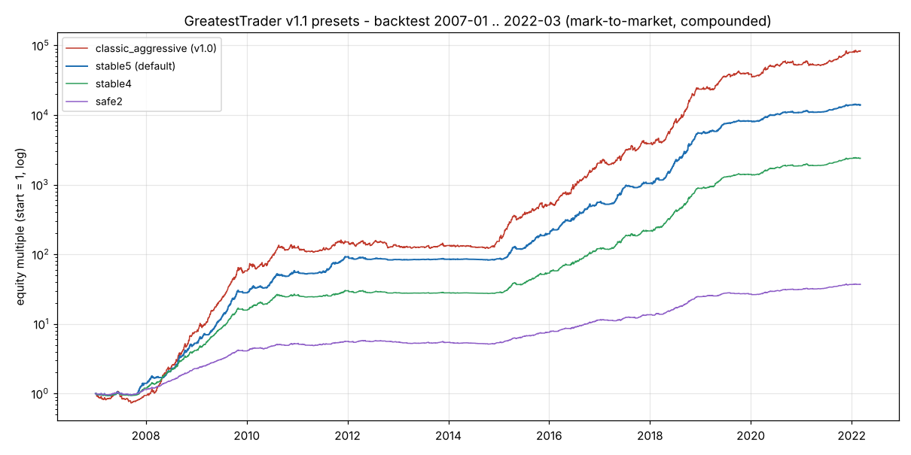
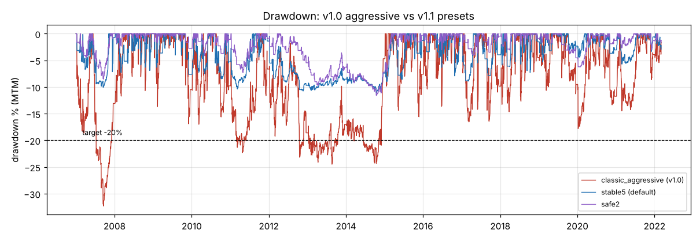
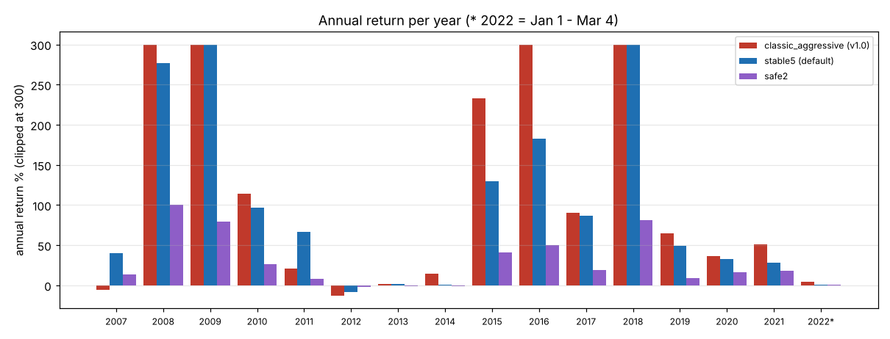
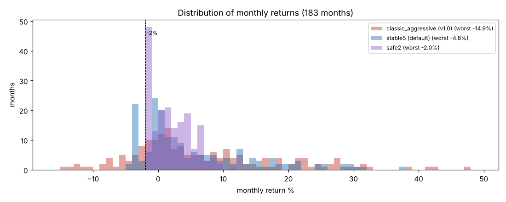

# GreatestTrader 安定化改修報告書（v1.1）

バージョン 1.1.0 ／ 検証期間 2007 年 1 月 1 日 〜 2022 年 3 月 4 日（約 15.2 年、182 か月＋部分月 1）

---

## 1. 結論

改修の目標は次の 3 つでした。

| 目標 | 内容 |
|---|---|
| ① 月利 | **5%**（v1.0 の目標を維持） |
| ② 最大ドローダウン | **20% 以内** |
| ③ 最悪月 | **−2% 程度** |

v1.1 では、リスク管理の機能を 10 種類追加しました（2 章）。約 1,440 通りの設定を探索し（3 章）、別の観点から敵対的に検証しました（5 章）。そのうえで、目的別の 3 つのプリセットを用意しました。

| プリセット | 月利（複利換算） | 最大 DD（含み損益込み） | 最悪月 | −2% を下回った月 | ① 5% | ② DD 20% | ③ −2% |
|---|---|---|---|---|---|---|---|
| **stable5（既定）** | **5.38%** | **−11.6%** | −4.75% | 27 か月 | ○ | ○ | × |
| stable4（堅牢） | 4.37% | −10.7% | −3.67% | 21 か月 | △ | ○ | × |
| safe2（最悪月重視） | 2.00% | −11.7% | **−2.00%** | **0 か月** | × | ○ | ○ |
| 参考：v1.0 aggressive | 6.42% | −33.0% | −14.93% | 34 か月 | ○ | × | × |

※ 数値は v1.1 のプログラムで再計算したものです（コストは 03 報告書と同じ）。v1.0 aggressive も v1.1 のバックテスター（年末年始の新規停止あり、保護機能の判定は含み損益込みの資産）で再計算しているため、03・04 報告書の値（6.34%、−33.7% など）とはわずかに異なります。

**正直な結論**

1. **3 つの目標をすべて同時に満たす設定は見つかりませんでした。** 「月利 5%」と「最大 DD 20% 以内」は両立できます（stable5）。しかし「最悪月 −2%」まで満たせるのは月利 2% 程度の設定（safe2）だけです。
2. 理由は、この戦略の損失が**「1 晩のショック」**に集中するためです。経済ショックの夜には、保有中のポジションが同じ 15 分足でまとめて損切りになります。そのため、月次の停止機能を入れても、1 晩の損失がその上限を超えてしまいます（3.3 節）。
3. 既定は、ご要望の優先順位（月利 5% を維持）に合わせて **stable5** にしました。最大 DD は v1.0 aggressive の −33.0% から **−11.6%** に、最悪月は −14.9% から **−4.75%** に縮小しています。
4. ただし **stable5 の月利 5% は、検証条件どおりのコストで初めて達成できる値**です。コストが 0.5 pips 高いと **3.50%**、中核ペアを後知恵なしで選ぶと **4.70%** に下がります（4.3 節・5.2 節）。本番の期待値としては、stable5・stable4 で月利 2.7〜3.5% 程度、safe2 で 1.3〜1.5% 程度を見込んでください。
5. 堅牢性（コスト上昇・損切りの滑り・急変動への耐性）を重視する場合は **stable4** を推奨します。1 取引のリスクが 2% に抑えられているため、想定外の急変動でも損失が小さく済みます。



---

## 2. 改修内容

### 2.1 追加したリスク管理機能

すべて Python 版と MQL5 版の両方に実装しています。既定のプリセット（stable5）で使っている機能には ★ を付けています。

| 機能 | 設定項目（Python / EA） | 内容 |
|---|---|---|
| ★ 通貨ペア別のリスク倍率（ティア制） | `symbol_risk_mult` / InpSymbolRiskMult | 通貨ペアごとにリスクを何倍にするかを指定する。中核 4 ペア（GBPCAD・EURCAD・AUDCAD・GBPCHF）は 1 倍、その他 10 ペアは 0.25 倍、のように使う |
| ★ 合計リスク上限 | `max_total_risk` / InpMaxTotalRisk | 保有中のポジションを全部損切りされたときの損失の合計（新規分を含む）を、資産の何 % までに抑えるか |
| ★ 同一通貨・同一方向の上限 | `max_same_direction_per_currency` / InpMaxSameDirPerCcy | 例えば「円買い」になるポジションを最大 2 つまでにする。同じ材料で一斉に損切りになるのを防ぐ |
| ★ 月次ハードストップ | `monthly_hard_stop` / InpMonthlyHardStop | 月初の資産から −x%（含み損益込み）になったら、**全ポジションを決済**し、その月は新規エントリーしない |
| 月次損失制限 | `monthly_loss_limit` / InpMonthlyLossLimit | 月初から −x% で、その月の新規エントリーだけを止める（保有中のポジションは決済しない） |
| 日次ハードストップ | `daily_hard_stop` / InpDailyHardStop | その日の開始資産から −x% で全決済し、その日は新規エントリーしない |
| ★ 年末年始の新規停止 | `blackout_start` / `blackout_end`（InpBlackoutStart / End） | マーケット時間の 12 月 20 日〜1 月 5 日は新規エントリーしない（流動性が極端に薄く、急変動が起きやすいため） |
| ボラティリティ目標 | `vol_target_daily` ほか | 日次の資産変動が目標に近づくようにリスクを増減する（検証で効果がなかったため、プリセットでは使っていない） |
| 資産曲線フィルター | `eq_filter_days` / `eq_filter_mult` | 資産が移動平均を下回っている間、リスクを減らす（同上） |
| ニュース急変フィルター | `max_band_z` / `max_bar_range_atr` | シグナル足が極端に大きいときは見送る（同上） |

既存の機能も、プリセットに合わせて設定値を変えています。

| 既存機能 | v1.0 の既定 | stable5 |
|---|---|---|
| DD 連動リスク縮小 | 倍率 = max(0.30, 1 − DD ÷ 30%) | 倍率 = max(**0.10**, 1 − DD ÷ **10%**)。DD 5% でリスク半分、DD 9% 以上で 1 割 |
| 日次損失制限 | −5% | **−1%** |

### 2.2 プリセット

設定はプリセット名を 1 行書くだけで切り替えられます（Python：`config.yaml` の `preset:`、または `--preset`。EA：`mql5/Presets/*.set` を読み込む）。

| 項目 | stable5（既定） | stable4 | safe2 | classic_*（v1.0 の 3 段階） |
|---|---|---|---|---|
| 中核 4 ペアの 1 取引リスク（`risk_nr`） | 3.5% | 2.0% | 1.0% | 0.5% / 1.0% / 1.5% |
| その他 10 ペアの倍率（実リスク） | 0.25（0.875%） | 0.4375（0.875%） | 0.5（0.5%） | 1（同じ） |
| Euro Session（`risk_es` × 倍率 0.25 / 0.4375 / 0.5） | 1.75% × 0.25 = 0.4375% | 1.0% × 0.4375 = 0.4375% | 0.5% × 0.5 = 0.25% | NR と同じ |
| 合計リスク上限 | 8.75% | 6.0% | 2.0% | なし |
| 同一通貨・同一方向の上限 | 2 | 2 | 2 | なし |
| DD 連動縮小（基準 / 下限） | 10% / 0.10 | 10% / 0.10 | 15% / 0.10 | 30% / 0.30 |
| 日次損失制限（新規停止） | 1% | 1% | 1% | 5% |
| 月次損失制限（新規停止） | なし | なし | 1.0% | なし |
| 月次ハードストップ（全決済） | 3% | 3% | 1.5% | なし |
| 年末年始の新規停止 | 12/20〜1/5 | 12/20〜1/5 | 12/20〜1/5 | 12/20〜1/5 |
| 1 取引の最大損失（実績、資産比） | 4.03% | 2.30% | 1.15% | 0.61% / 1.20% / 1.85% |

※ 「その他 10 ペア」は EURJPY, GBPJPY, USDJPY, GBPUSD, EURGBP, USDCHF, EURUSD, EURAUD, CHFJPY, GBPAUD です。EURUSD の倍率は Euro Session にも適用されます。
※ ロットは `risk_nr`（× 倍率 × DD 縮小倍率）を超えないように計算します。1 取引の最大損失がそれを少し超えるのは、損切りが窓を開けて不利な価格（足の始値）で約定したり、コストが加わったりするためです（最大で損切り幅の 1.26 倍＝1.26R）。

### 2.3 各機能が効く理由

| 機能 | 効果（検証結果より） |
|---|---|
| ティア制 | 中核 4 ペアは、2007〜2019 年の 13 年中 12 年で他のペアより 1 取引あたりの利益（R）が大きかった。互いの相関も低い。リスクを中核に寄せることで、設計期間では同じリターンのまま、最悪月が −14.2% → −7.9%、DD が −33% → −18% に下がった |
| 同一方向の上限 | 1 晩に 10 以上のシグナルが出る夜は、取引間の相関が 0.30 まで上がり、実質的な独立の賭けは約 3 つしかない。同じ通貨を同じ方向に賭ける数を 2 に抑えると、この「重い夜」の損失が減る。**1 にすると利益が 3〜4 割減る**（崖）ため、2 が適正 |
| 合計リスク上限 | 1 晩の最大損失をおよそ上限の値に抑える。単独ではリターンも同じだけ減る。ティア制と組み合わせた場合、設計期間ではほぼ中立だったが、検証期間では最悪月（−6.1% → −4.0%）と DD（−13.2% → −8.9%）が大きく改善した |
| 速い DD 縮小 | 最も強い DD 対策。資産が最高値から 5% 下がるとリスクが半分になるため、連敗が続いても DD が深くならない。代わりに、回復に時間がかかり、月利の中央値が下がる |
| 日次 1% 停止 | その日の新規エントリーを止めるだけだが、5% から 1〜2% に下げると、リターンをほぼ変えずに DD が 3〜5 ポイント下がった。設計期間では 0.5%・2% より 1% が良かった |
| 月次ハードストップ | 月の損失を「上限 ＋ 1〜2%」程度に抑える。上限ちょうどで止まらないのは、1 晩の損失が 15 分足 1 本の中で発生し、停止判定より先に起きるため |
| 年末年始の停止 | 年末年始の薄商いでは、2016-12-30 や 2019-01-03（円のフラッシュクラッシュ）のように、損切りから大きく滑る急変動が起きている。通常のリターンにはほぼ影響がなく（8 つの設定の平均で月利 −0.03%）、急変動時の損失を大きく減らす（5.4 節） |

---

## 3. 探索の方法と結果

> 本章の数値は探索時のもので、年末年始の新規停止を入れる前の設定・プログラムで計算しています。そのため、同じ設定でも 1 章・4 章の最終的な数値とは少し異なります（例：v1.0 aggressive の最悪月は探索時 −14.2%、最終 −14.9%。stable5 の最大 DD は探索時 −12.6%、最終 −11.6%）。

### 3.1 方法

- 4 つの系統で、合計 約 1,440 通りのバックテストを行いました。

| 系統 | 内容 | 実行数 |
|---|---|---|
| ポートフォリオのリスク管理 | 1 取引のリスク、合計リスク上限、同時保有・同一通貨・同一方向の上限、日次・月次の停止、DD 縮小 | 555 |
| 取引の選別 | 通貨ペアの入れ替え、ニュース急変フィルター、コストフィルター、損切り・保有時間・バンド幅 | 200 |
| 適応的なリスク調整 | ボラティリティ目標、資産曲線フィルター、速い DD 縮小 | 365 |
| 分散と相関の管理 | ティア制、通貨別の重み、追加ペア、Euro Session の重み | 321 |

- **設定は 2007〜2016 年（設計期間）のデータだけで選び**、2017〜2022 年（検証期間）は確認にだけ使いました。
- 選んだ設定は、別の担当（エージェント）が次の 3 つの観点で敵対的に検証しました。
  1. パラメータを ±25% 動かしたときの安定性
  2. 中核ペアの選び方に後知恵がないか
  3. コスト上昇・損切りの滑り・急変動へのストレス耐性

### 3.2 リターンと最悪月の関係（効率的フロンティア）

検証条件どおりのコストで、最悪月を小さくしようとすると、月利は次のように下がります。

| 月利（複利換算） | 最悪月 | 最大 DD | 代表的な設定 |
|---|---|---|---|
| 約 2.2% | 約 −2.0% | 約 −11% | safe2 系 |
| 約 3.2% | 約 −2.8% | 約 −13% | 中間（月次停止 2%） |
| 約 5.3% | 約 −4.75% | 約 −12.6% | stable5 |
| 約 6.0% | 約 −4.8% | 約 −15.5% | stable5 の DD 縮小を緩めたもの |
| 約 6.6% | 約 −7.5% | 約 −16% | DD 20% 以内で最大のリターン |
| 6.4%（参考） | −14.2% | −33% | v1.0 aggressive |

月次停止を使うこのフロンティア上でも、**最悪月の大きさは月利とほぼ同じ（約 0.9〜1.1 倍）**です（停止を使わない場合は約 1.25〜1.6 倍）。したがって最悪月を −2% にすると、月利もおよそ 2% になります。「月利 5% かつ最悪月 −2%」はこの線から大きく外れています。

### 3.3 最悪月 −2% と月利 5% が両立しない理由

1. **1 取引あたりの優位性が小さい。** 月 約 110 回の取引で、平均 +0.05R 程度の利益を積み上げる戦略です。R 単位で見ると、月平均 +5.6R、標準偏差 9.0R、最悪月 −22.9R（2012 年 10 月、アベノミクス相場）でした。固定比率では「月平均 ÷ 最悪月」は約 0.24 です。そのため最悪月を −2% にすると、月利は約 0.5% になってしまいます。
2. **損失は「1 晩のショック」に集中する。** 2016-10-25、2018-10-11、2007-12-12 のような夜は、保有中のポジションが同じ 15 分足でまとめて損切りになります（探索時には年末年始の 2010-12-28、2019-01-03 も同様でした。この 2 晩は v1.1 では新規停止の期間に入ります）。1 晩の損失はほぼ「合計リスク上限」と同じ大きさになります。
3. **月次の停止は 1 晩の損失を止められない。** 停止の判定は足の確定ごとに行います。1 本の足の中で起きた損失は、判定より先に発生します。そのため、月の損失は「停止ライン ＋ 1〜2%」程度まで行きます（stable5 は停止ライン 3% に対して最悪月 −4.75%）。
4. 停止ラインを 1.5% 程度まで下げ、合計リスクを 2% に絞れば、最悪月は −2% 前後になります（safe2）。しかし同時に持てるリスクが小さくなるため、月利は 2% 前後にとどまります。

### 3.4 効果がなかった施策

| 施策 | 結果 |
|---|---|
| ボラティリティ目標 | レバレッジを上げ下げするだけで、リスク当たりのリターン（シャープレシオ）は改善しない。変動の大きさが日をまたいで続く性質がほとんどない（自己相関 0.04）ため |
| 資産曲線フィルター | 単独では悪化。月次停止と組み合わせると −2% 未満の月は減るが、月利も下がる |
| ニュース急変フィルター | 急変はエントリーの**後**に起きるため、シグナル足で判定しても損失は減らない |
| コストフィルターの強化（2.25〜3.0 倍） | 設計期間では最も効果があったが、検証期間で成績が大きく悪化したため不採用（相場環境の違いによる見かけの効果） |
| 円クロスの除外 | 効果はあったが、ティア制（円クロスを 0.25 倍）で同じ効果がより安定して得られた |
| 通貨ペアの追加（CADCHF・USDCAD・AUDNZD など） | 設計期間の最悪月は改善したが、検証期間では悪化した |
| 日次ハードストップ | 1 晩の損失は 15 分足 1 本の中で起きるため、ほとんど効かない |
| 同一方向の上限を 1 にする | 利益が 3〜4 割減る（崖）。2 と 3 はほぼ同じ |

---

## 4. バックテスト結果（v1.1）

検証条件は [03_バックテスト報告書.md](03_バックテスト報告書.md) の 2 章と同じです（コストは往復でスプレッド＋手数料、さらに NR +0.5 pips・ES +0.3 pips のスリッページ）。v1.1 のプログラム（`python main.py backtest --preset <名前>`）で計算しています。

### 4.1 全期間（2007/01〜2022/03）

| プリセット | 月利 複利換算 | 月利 単純平均 | 月利 中央値 | 年利（CAGR） | 最大 DD（含み損益込み） | 最悪月 | −2% を下回った月 | プラス月 | シャープ | 1 取引の最大損失 |
|---|---|---|---|---|---|---|---|---|---|---|
| stable5 | 5.38% | 5.73% | 2.38% | 87.6% | −11.6% | −4.75% | 27 / 182 | 69% | 2.25 | 4.03% |
| stable4 | 4.37% | 4.55% | 2.54% | 67.0% | −10.7% | −3.67% | 21 / 182 | 71% | 2.47 | 2.30% |
| safe2 | 2.00% | 2.05% | 1.34% | 26.9% | −11.7% | −2.00% | 0 / 182 | 66% | 2.30 | 1.15% |
| classic_conservative | 2.58% | 2.66% | 1.95% | 35.7% | −18.2% | −8.69% | 21 / 182 | 73% | 2.20 | 0.61% |
| classic_standard | 4.73% | 5.03% | 3.09% | 74.2% | −26.3% | −13.07% | 28 / 182 | 70% | 2.16 | 1.20% |
| classic_aggressive | 6.42% | 7.02% | 3.57% | 111.1% | −33.0% | −14.93% | 34 / 182 | 70% | 2.08 | 1.85% |

- 「−2% を下回った月」は、完全な 182 か月のうち月利が −2% 未満だった月の数です。
- シャープレシオは月利（完全月）の平均 ÷ 標準偏差 × √12 です。



### 4.2 期間別（基本コスト）

各セルは「月利（複利換算） / 最悪月 / 最大 DD（含み損益込み）」です。

| 期間 | stable5<br>月利（複利） / 最悪月 / DD | stable4<br>月利（複利） / 最悪月 / DD | safe2<br>月利（複利） / 最悪月 / DD |
|---|---|---|---|
| 2007/01〜2022/03（全期間） | 5.38% / −4.75% / −11.6% | 4.37% / −3.67% / −10.7% | 2.00% / −2.00% / −11.7% |
| 2007〜2016（設計期間） | 5.41% / −4.75% / −11.6% | 4.07% / −3.67% / −10.7% | 2.05% / −1.87% / −11.7% |
| 2017/01〜2022/03（検証期間） | 5.33% / −3.38% / −9.0% | 4.93% / −3.53% / −6.6% | 1.92% / −2.00% / −6.4% |
| 2011/01〜2022/03 | 4.22% / −4.18% / −11.6% | 3.44% / −3.53% / −10.7% | 1.48% / −2.00% / −11.7% |
| 2017/01〜2019/06（14 ペアそろう検証期間） | 9.08% / −3.38% / −9.0% | 8.24% / −3.53% / −6.6% | 3.01% / −2.00% / −4.7% |
| 2019/07〜2022/03（中核 4 ペアのデータなし） | 1.95% / −3.02% / −6.0% | 1.95% / −3.02% / −6.0% | 0.91% / −1.78% / −6.4% |

- **2019 年 7 月以降は、中核 4 ペアを含む 7 ペアのデータがありません。** この期間はその他 7 ペア（倍率 0.25 など）と Euro Session だけが取引しているため、stable5 と stable4 はまったく同じ結果になります（7 ペアの実リスク 0.875% と Euro Session の実リスク 0.4375% が同じで、合計リスク上限の差もこの期間は効かず、期間の始まりの DD もほぼ同じだったため）。月利が低いのは主にデータ不足によるもので、戦略の劣化を示すものではありません。ただし、中核ペアの 2019 年 7 月以降の成績は確認できていません。
- 14 ペアすべてのデータがそろう検証期間（2017/01〜2019/06）では、stable5 は月利 9.08% でした。

### 4.3 コストを 0.5 pips 悪化させた場合

| 期間 | stable5<br>月利（複利） / 最悪月 / DD | stable4<br>月利（複利） / 最悪月 / DD | safe2<br>月利（複利） / 最悪月 / DD |
|---|---|---|---|
| 2007/01〜2022/03（全期間） | 3.50% / −5.29% / −11.8% | 2.76% / −4.20% / −11.2% | 1.33% / −1.98% / −11.9% |
| 2007〜2016（設計期間） | 4.18% / −5.29% / −11.8% | 2.95% / −4.20% / −11.2% | 1.50% / −1.80% / −11.9% |
| 2017/01〜2022/03（検証期間） | 2.20% / −4.92% / −9.1% | 2.40% / −3.58% / −7.7% | 0.98% / −1.98% / −6.6% |
| 2011/01〜2022/03 | 2.23% / −4.92% / −11.8% | 1.80% / −3.69% / −11.2% | 0.76% / −1.98% / −11.9% |
| 2017/01〜2019/06（14 ペアそろう検証期間） | 4.05% / −4.92% / −9.1% | 4.48% / −3.32% / −7.7% | 1.83% / −1.98% / −5.8% |
| 2019/07〜2022/03（中核 4 ペアのデータなし） | 0.50% / −3.58% / −7.6% | 0.50% / −3.58% / −7.6% | 0.20% / −1.73% / −6.6% |

| プリセット | 月利 複利換算 | 最悪月 | 最大 DD | 2017〜2022 月利 | 2019/07〜2022/03 月利 |
|---|---|---|---|---|---|
| stable5 | 3.50% | −5.29% | −11.8% | 2.20% | 0.50% |
| stable4 | 2.76% | −4.20% | −11.2% | 2.40% | 0.50% |
| safe2 | 1.33% | −1.98% | −11.9% | 0.98% | 0.20% |
| classic_conservative | 1.62% | −8.14% | −18.2% | 0.87% | 0.14% |
| classic_standard | 2.88% | −12.88% | −26.3% | 1.52% | 0.10% |
| classic_aggressive | 3.83% | −15.39% | −32.1% | 1.78% | −0.06% |

- コストが 0.5 pips 上がると、stable5 の月利は 5.38% → 3.50%（約 35% 減）、2017〜2022 年では 5.33% → 2.20%（約 6 割減）になります。**v1.1 でもコストに敏感な性質は変わりません。**
- 最悪月と最大 DD は、コストが上がってもほとんど悪化しません（月次停止と DD 縮小が働くため）。

### 4.4 年利（各年、%）

| 年 | stable5 | stable4 | safe2 | classic_conservative | classic_standard | classic_aggressive |
|---|---|---|---|---|---|---|
| 2007 | +40.06 | +19.63 | +14.01 | +1.36 | −1.49 | −6.04 |
| 2008 | +276.70 | +248.00 | +100.47 | +121.14 | +353.35 | +718.18 |
| 2009 | +430.46 | +279.05 | +79.36 | +104.73 | +302.69 | +652.43 |
| 2010 | +96.87 | +63.14 | +26.67 | +43.42 | +83.64 | +114.47 |
| 2011 | +66.29 | +16.34 | +8.05 | +9.02 | +14.26 | +21.06 |
| 2012 | −8.41 | −6.78 | −2.38 | −2.54 | −7.12 | −12.82 |
| 2013 | +1.29 | +0.07 | −0.87 | +3.15 | +0.98 | +1.96 |
| 2014 | +1.22 | +1.02 | −1.01 | +9.91 | +11.35 | +14.83 |
| 2015 | +129.18 | +90.01 | +41.14 | +60.31 | +137.35 | +232.78 |
| 2016 | +182.89 | +124.73 | +50.02 | +79.13 | +188.74 | +300.20 |
| 2017 | +86.77 | +79.82 | +18.94 | +32.02 | +67.64 | +90.10 |
| 2018 | +427.05 | +308.61 | +81.65 | +97.53 | +271.48 | +506.09 |
| 2019 | +49.35 | +58.64 | +9.15 | +24.98 | +50.97 | +64.72 |
| 2020 | +32.73 | +32.73 | +16.47 | +16.21 | +29.29 | +36.64 |
| 2021 | +27.99 | +27.99 | +17.96 | +16.56 | +33.17 | +51.01 |
| 2022* | +0.36 | +0.36 | +0.38 | +2.10 | +3.55 | +4.69 |

\* 2022 年は 1/1〜3/4 の部分期間です。



- マイナスの年は、stable5・stable4 が 2012 年の 1 回、safe2 が 2012〜2014 年の 3 回（いずれも −2.4% 以内）でした。
- stable5 は **2012〜2014 年の 3 年間、ほぼ横ばい**（−8.4%、+1.3%、+1.2%）でした。DD 縮小が働いている間はリスクが小さくなるため、回復にも時間がかかります。
- 収益は変動の大きい年に偏っています。stable5 の対数成長のうち、上位 3 年（2009・2018・2008 年）で約 5 割を占めます。

### 4.5 月利の分布



| | stable5 | stable4 | safe2 | v1.0 aggressive |
|---|---|---|---|---|
| マイナスの月 | 57 | 53 | 61 | 54 |
| −1% 未満の月 | 33 | 28 | 48 | 44 |
| −2% 未満の月 | 27 | 21 | 0 | 34 |
| −3% 未満の月 | 24 | 18 | 0 | 26 |
| −5% 未満の月 | 0 | 0 | 0 | 18 |
| 月次ハードストップが発動した月 | 24 | 18 | 21 | — |

※ 完全な 182 か月（2022 年 3 月の部分月を除く）で数えています。月次ハードストップの発動月には、発動時点で決済するポジションが残っていなかった月（その晩のポジションがすでに損切りされていた月。stable5 で 1、stable4 で 3、safe2 で 2 か月）を含みます。

- −2% を下回った月（stable5 27 か月、stable4 21 か月）の多く（21 か月、16 か月）は、月次ハードストップ（−3%）付近の −3.0〜−3.4% で止まっています。−5% を下回る月はありません。負けた月の多くは −1% 未満の小さな負けです。
- 代わりに「−2% を下回る月」は v1.0 と同じくらいの頻度（年に 1〜2 回）で起きます。

---

## 5. 頑健性の検証

検証は、選定に関わっていない担当が、選定時の数値をまず再現したうえで行いました。本章の数値は検証時のもので、一部は年末年始の新規停止を入れる前の設定です（stable5 の基準値は 5.32%／DD −12.6%。年末年始の停止を入れた最終版は 5.38%／DD −11.6%）。

### 5.1 パラメータを ±25% 動かした場合

| プリセット | 月利の範囲 | 最大 DD の範囲 | 最悪月の範囲 | 注意点 |
|---|---|---|---|---|
| stable5 | 4.61〜5.73% | −10.8〜−15.1% | −3.71〜−5.97% | 同一方向の上限を 1 にすると 3.52%（−34%）に急落 |
| stable4 | 3.46〜4.79% | −9.1〜−12.3% | −3.62〜−4.69% | 主に `risk_nr` で変わる。他の項目は −11〜+5% の範囲 |
| safe2 | 1.95〜2.50%（旧案） | −8.3〜−13.1%（旧案） | −1.79〜−2.62%（旧案） | ±25% の確認は採用前の旧案（中核 1.25%・その他 0.25 倍）で実施。「−2% を下回る月 0」はぎりぎりの値で、16 通り中 7 通りで −2.0〜−2.6% になった。そのため、条件の変化に強い現在の safe2（中核 1.0%・その他 0.5 倍）に差し替えた。現在の safe2 の最悪月は、コスト・損切りの滑りのストレス下で −1.98〜−2.33%（急変動ストレスでは −2.56%） |

### 5.2 中核ペアの選び方（後知恵の影響）

中核 4 ペアは設計期間（2007〜2016 年）全体のデータを見て選んでいるため、その期間内では後知恵が入っており、その分だけ成績が良く見えている可能性があります。そこで次の 2 つを確認しました。

| 確認方法 | stable5 | stable4 | safe2 |
|---|---|---|---|
| 実際の中核（GBPCAD・EURCAD・AUDCAD・GBPCHF） | 5.32% | 4.33% | 2.11% |
| **後知恵なしで選んだ中核**（各時点までのデータだけで選ぶと GBPCHF の代わりに EURAUD） | **4.70%** | **4.14%** | **2.02%**（最悪月 −2.16%） |

- ランダムに選んだ中核と比べると、実際の中核は全期間で上位 0〜5%（14 ペアがそろう検証期間 2017〜2019 年だけでは上位 15%）に入ります。**stable5 の月利のうち約 0.6〜0.8% は、選び方の後知恵による上乗せ**と考えられます。
- stable5・stable4 の最大 DD と最悪月は、中核の選び方を変えてもほとんど変わりませんでした。safe2 は最大 DD が −9.9% → −12.9% に悪化しました（最悪月は −2.16% で同じ）。
- 一方、中核ペアが他のペアより良い成績を出していたのは 13 年中 12 年で、検証期間（2017〜2019 年）でも同じでした。ティア制そのものの効果は後知恵だけでは説明できません。

### 5.3 ストレステスト

| 条件 | stable5 | stable4 | safe2 |
|---|---|---|---|
| 基準 | 5.32% / DD −12.6% | 4.33% / DD −10.8% | 2.11% / DD −9.9% |
| コスト +0.5 pips | 3.40% / DD −12.8% | 2.65% / DD −11.2% | 1.35% / DD −12.1% |
| 損切りが毎回 0.3R 不利に約定 | 3.22% / DD −17.3% | 2.30% / DD −16.7% | 1.29% / DD −15.1% |
| 上の 2 つを同時に | 1.55% / DD −19.0% | 1.15% / DD −18.7% | 0.70% / DD −15.3% |
| 急変動の足で損切りが足の高値・安値で約定（年末年始の停止なし） | DD −25.5%、最悪月 −20.4% | DD −23.6% | 最悪月 −18.5% |
| 同上（**年末年始の停止あり**） | **DD −14.0%、最悪月 −6.87%** | **DD −12.6%** | **最悪月 −2.56%** |

- 年末年始の停止があれば、すべてのストレスで最大 DD は 20% 以内に収まりました。
- 「コスト +0.5 pips」と「損切りの滑り」が重なると、月利は 1〜1.5% 程度まで下がります。**コストが最大の弱点**です。

### 5.4 年末年始の新規停止について

- 通常の成績への影響はほぼゼロです（8 つの設定の平均で月利 −0.03%）。
- 急変動のストレスでは効果が大きく、stable5 の DD を −25.5% → −14.0%、stable4 を −23.6% → −12.6% に改善しました。
- ただし、この効果は主に 1 つの事件（2019-01-03 の円の急変動）によるものです。採用の根拠は「年末年始は流動性が極端に薄い」という構造的な理由にあります。

### 5.5 1 取引の大きさと急変動のリスク

取引時間帯には、損切りが急変動の足の高値・安値で約定したと仮定すると、損失が損切り幅の 10〜13 倍（10〜13R）になる急変動が 2 回ありました（2016-10-07 のポンド急落、2019-01-03 の円の急騰）。同じことが中核ペアの満額ポジションで起きた場合、損失は次のとおりです。

| プリセット | 中核ペアの 1 取引リスク | 10〜13R の急変動 1 回の損失 |
|---|---|---|
| stable5 | 3.5% | 資産の約 35〜46% |
| stable4 | 2.0% | 約 20〜26% |
| safe2 | 1.0% | 約 10〜13% |
| v1.0 aggressive | 1.5% | 約 15〜20% |

stable5 は、このような急変動が 1 回でも起きると、DD 20% の目標を大きく超えます。**データにない種類の急変動（スイスフランショックのような事件）まで考えると、stable4 の方が安全**です。

---

## 6. 目標の達成状況（正直な評価）

| | ① 月利 5% | ② 最大 DD 20% 以内 | ③ 最悪月 −2% 程度 |
|---|---|---|---|
| stable5 | **検証条件どおりのコストでは達成**（5.38%）。後知恵なしの中核で 4.70%、コスト +0.5 pips で 3.50%、2011〜2022 年は 4.22% | **達成**（−11.6%）。ストレス下でも −19.0% 以内。ただし急変動の大きな滑りが中核ペアで起きると超える | **未達**（−4.75%、−2% 未満の月 27 か月） |
| stable4 | 未達（4.37%、コスト +0.5 pips で 2.76%） | **達成**（−10.7%、ストレス下でも −18.7% 以内） | 未達（−3.67%、21 か月） |
| safe2 | 未達（2.00%、コスト +0.5 pips で 1.33%） | **達成**（−11.7%、ストレス下でも −15.3% 以内） | **達成**（−2.00%、−2% 未満の月 0） |

- **3 つの目標を同時に満たす設定はありません。** これは設定の問題ではなく、戦略の性質（1 晩のショックによる損失）による限界です。
- v1.0 と比べると、同程度の月利（stable5 5.38% 対 v1.0 standard 4.73%〜aggressive 6.42%）で、最大 DD を約 1/3、最悪月を約 1/3 に縮小できました。シャープレシオも 2.08（aggressive）→ 2.25（stable5）・2.47（stable4）に改善しています。
- **本番での現実的な期待値**（中核ペアの優位性が続き、コストが検証より 0.5 pips 程度高いと仮定）：
  - stable5・stable4：月利 約 2.7〜3.5%
  - safe2：月利 約 1.3〜1.5%

---

## 7. プリセットの選び方

| 優先したいこと | おすすめ |
|---|---|
| 月利 5% を目指す（新しいプリセットの中で唯一 5% を超える） | **stable5**（既定） |
| DD を抑えつつ、想定外の急変動にも備えたい | **stable4**（推奨の中間案） |
| 毎月の損失を −2% 前後に抑えたい | **safe2** |
| v1.0 のリスク設定（保護機能なし。年末年始の新規停止は有効。v1.0 と完全に同じにするには `blackout_start` / `blackout_end` を空欄に） | classic_conservative / classic_standard / classic_aggressive |

**必要なレバレッジ（合計建玉 ÷ 口座資産）**

| プリセット | 中央値 | 上位 5% | 最大 |
|---|---|---|---|
| stable5 | 約 3 倍 | 約 23 倍 | **約 67 倍** |
| stable4 | 約 3 倍 | 約 19 倍 | 約 46 倍 |
| safe2 | 約 2 倍 | 約 10 倍 | 約 18 倍 |
| classic_conservative | 約 4 倍 | 約 15 倍 | 約 30 倍 |
| classic_standard | 約 6 倍 | 約 26 倍 | 約 58 倍 |
| classic_aggressive | 約 8 倍 | 約 36 倍 | 約 87 倍 |

- 国内口座（最大 25 倍）では、stable5・stable4 は証拠金不足で見送られる取引が出ます（自動で見送るため安全ですが、成績は検証より下がります）。**国内口座では safe2 が無理なく動きます。**
- stable5 は最大で資産の約 67 倍の建玉になるため、100 倍以上の口座が必要です。

**始め方**

1. デモ口座で 2〜4 週間、選んだプリセットで動作を確認します。
2. 本番は、**プリセットのリスクを半分以下にして**始めます（例：`risk_nr` を stable5 の 3.5% → 1.75%）。実際のコスト（スプレッド＋手数料＋滑り）が検証の想定に近いことを確認してから、元の値に戻してください。
3. 中核 4 ペア（GBPCAD・EURCAD・AUDCAD・GBPCHF）は 2019 年 7 月以降のデータで検証できていません。**ご自身のブローカーのデータで MT5 ストラテジーテスターによる確認を必ず行ってください。**

---

## 8. 月利（各月）・年利（各年）の全表

- 月利 ＝ 月末の資産 ÷ 前月末の資産 − 1、年利 ＝ 年末の資産 ÷ 前年末の資産 − 1 です（計算方法の詳細は [04_月利年利検証報告書.md](04_月利年利検証報告書.md) の 2 章）。
- 太字の月は −2% 未満の月です。2022 年は 3 月 4 日までの部分期間です。
- 資産額は「全額を複利で再投資し、ロットや流動性の上限がない」という前提の計算値です。実際には、資産が大きくなるとブローカーの最大ロットや市場の流動性の制約を受けるため、この金額にはなりません。月利・年利の比較用としてご覧ください。

### 8.1 stable5（既定）の月利（%）

| 年 | 1月 | 2月 | 3月 | 4月 | 5月 | 6月 | 7月 | 8月 | 9月 | 10月 | 11月 | 12月 | 年間 |
|---|---|---|---|---|---|---|---|---|---|---|---|---|---|
| 2007 | **−3.15** | −1.81 | −1.69 | +2.80 | +2.46 | +0.08 | **−2.16** | −0.20 | +0.08 | +4.50 | +28.42 | +8.37 | **+40.06** |
| 2008 | +16.69 | +1.65 | +5.42 | **−3.03** | +14.22 | +7.79 | +14.43 | +37.12 | +7.76 | +19.71 | +12.40 | +10.90 | **+276.70** |
| 2009 | +17.02 | +17.09 | **−3.22** | +18.72 | +24.37 | +15.65 | +21.64 | +28.32 | +24.10 | +30.94 | **−4.75** | **−3.02** | **+430.46** |
| 2010 | +13.97 | +3.81 | +2.39 | **−3.14** | +1.64 | +18.11 | +25.33 | +0.68 | −1.25 | −0.97 | +9.92 | +3.05 | **+96.87** |
| 2011 | **−3.03** | −1.40 | +0.73 | −0.31 | +1.27 | +2.30 | +5.94 | +14.56 | +9.70 | +3.88 | +11.48 | +8.42 | **+66.29** |
| 2012 | **−4.18** | **−3.01** | +5.39 | **−2.61** | **−3.08** | +0.80 | +2.69 | −1.84 | −0.33 | **−3.06** | +1.10 | −0.19 | **−8.41** |
| 2013 | −0.71 | +0.55 | −0.09 | +0.68 | −0.49 | +0.69 | +0.19 | −0.16 | +0.36 | +0.86 | −0.48 | −0.10 | **+1.29** |
| 2014 | +0.04 | −0.09 | −0.30 | +0.83 | −0.67 | −0.09 | −0.42 | −0.41 | −0.85 | −0.09 | −0.32 | +3.66 | **+1.22** |
| 2015 | −0.71 | +6.13 | +21.63 | +12.12 | **−3.37** | +1.97 | +12.31 | +10.90 | +15.36 | +10.01 | **−3.67** | +6.30 | **+129.18** |
| 2016 | +17.88 | **−3.39** | +20.13 | +15.70 | **−3.25** | +6.91 | +12.93 | +8.29 | +13.57 | +8.90 | +2.36 | +11.62 | **+182.89** |
| 2017 | **−3.26** | **−3.16** | +3.57 | +12.07 | +19.44 | +25.63 | +6.75 | **−3.36** | **−3.27** | +7.08 | +10.88 | **−3.38** | **+86.77** |
| 2018 | +3.35 | +12.04 | **−3.29** | +14.40 | +21.07 | +31.73 | +7.51 | +20.93 | +12.55 | +29.71 | +29.99 | +4.56 | **+427.05** |
| 2019 | +0.78 | +1.20 | +7.39 | **−3.10** | +17.68 | +9.76 | +1.90 | +4.83 | +2.38 | −0.81 | +0.68 | −0.24 | **+49.35** |
| 2020 | −1.30 | +1.23 | +8.18 | +5.81 | +5.95 | +2.88 | +0.88 | +6.10 | +0.62 | +1.29 | **−3.02** | +0.65 | **+32.73** |
| 2021 | +3.50 | **−3.01** | +0.23 | +1.07 | −0.01 | +2.15 | +4.98 | +3.60 | +5.10 | +2.50 | +3.74 | +1.38 | **+27.99** |
| 2022* | +2.57 | **−2.27** | +0.12 |  |  |  |  |  |  |  |  |  | **+0.36** |

### 8.2 stable4 の月利（%）

| 年 | 1月 | 2月 | 3月 | 4月 | 5月 | 6月 | 7月 | 8月 | 9月 | 10月 | 11月 | 12月 | 年間 |
|---|---|---|---|---|---|---|---|---|---|---|---|---|---|
| 2007 | **−3.15** | **−2.34** | −1.42 | +2.52 | +2.43 | −1.52 | −1.64 | −0.82 | −0.04 | +2.44 | +12.67 | +10.22 | **+19.63** |
| 2008 | +12.03 | +1.35 | +8.20 | +17.05 | +14.23 | +6.85 | +11.88 | +22.79 | +7.47 | +11.00 | +10.56 | +9.42 | **+248.00** |
| 2009 | +11.16 | +10.31 | +14.16 | +14.89 | +15.57 | +10.72 | +14.60 | +19.32 | +17.46 | +22.91 | **−3.67** | **−3.13** | **+279.05** |
| 2010 | +9.46 | +7.60 | +6.24 | **−3.14** | +1.39 | +12.38 | +17.06 | −0.62 | **−2.10** | −0.73 | +3.85 | +0.61 | **+63.14** |
| 2011 | **−3.12** | −1.98 | +0.30 | −0.46 | +0.70 | +1.29 | +4.43 | **−3.07** | +4.06 | +3.07 | +6.56 | +4.00 | **+16.34** |
| 2012 | **−3.06** | **−3.04** | +5.12 | −1.86 | **−3.03** | +0.78 | +3.12 | −1.41 | −0.51 | **−3.06** | +0.94 | −0.62 | **−6.78** |
| 2013 | −0.92 | +0.27 | −0.09 | +0.43 | −0.45 | +0.48 | +0.15 | −0.48 | +0.16 | +0.93 | −0.50 | +0.10 | **+0.07** |
| 2014 | +0.06 | −0.47 | −0.13 | +0.47 | −0.37 | −0.21 | −0.33 | −0.20 | −0.51 | −0.05 | −0.13 | +2.93 | **+1.02** |
| 2015 | +0.54 | +6.69 | +15.08 | +9.06 | **−3.29** | +3.37 | +9.43 | +7.06 | +7.80 | +10.68 | **−3.02** | +4.15 | **+90.01** |
| 2016 | +11.51 | **−3.25** | +13.95 | +9.88 | **−3.13** | +6.17 | +6.66 | +10.35 | +8.70 | +8.33 | +6.19 | +9.92 | **+124.73** |
| 2017 | +1.26 | **−3.07** | +5.37 | +9.34 | +7.81 | +20.41 | +6.54 | +1.40 | **−3.53** | +10.58 | +6.73 | −0.41 | **+79.82** |
| 2018 | +2.58 | +9.19 | +4.97 | +15.38 | +16.45 | +20.49 | +5.09 | +15.79 | +13.52 | +24.23 | +20.74 | +3.60 | **+308.61** |
| 2019 | +1.27 | +1.68 | +4.13 | +11.51 | +13.79 | +7.01 | +1.90 | +4.83 | +2.38 | −0.81 | +0.68 | −0.24 | **+58.64** |
| 2020 | −1.30 | +1.23 | +8.18 | +5.81 | +5.95 | +2.88 | +0.88 | +6.10 | +0.62 | +1.29 | **−3.02** | +0.65 | **+32.73** |
| 2021 | +3.50 | **−3.01** | +0.23 | +1.07 | −0.01 | +2.15 | +4.98 | +3.60 | +5.10 | +2.50 | +3.74 | +1.38 | **+27.99** |
| 2022* | +2.57 | **−2.27** | +0.12 |  |  |  |  |  |  |  |  |  | **+0.36** |

### 8.3 safe2 の月利（%）

| 年 | 1月 | 2月 | 3月 | 4月 | 5月 | 6月 | 7月 | 8月 | 9月 | 10月 | 11月 | 12月 | 年間 |
|---|---|---|---|---|---|---|---|---|---|---|---|---|---|
| 2007 | −1.61 | −1.20 | −1.07 | +2.36 | +2.54 | −1.68 | −1.52 | −1.87 | +0.75 | +4.18 | +6.31 | +6.54 | **+14.01** |
| 2008 | +3.75 | +1.29 | +5.45 | +8.52 | +6.21 | +4.68 | +6.73 | +9.68 | +5.38 | +6.48 | +6.90 | +6.79 | **+100.47** |
| 2009 | +4.94 | +4.45 | +5.36 | +5.37 | +6.16 | +4.64 | +6.91 | +8.22 | +7.78 | +9.44 | −1.60 | −1.18 | **+79.36** |
| 2010 | +6.42 | +3.74 | −1.14 | −1.64 | +2.36 | +5.95 | +4.85 | +0.97 | −1.18 | −1.45 | +4.63 | +0.87 | **+26.67** |
| 2011 | −1.78 | −1.34 | −1.58 | −1.49 | +1.29 | +2.09 | +3.03 | −1.28 | +3.69 | +1.28 | +2.91 | +1.19 | **+8.05** |
| 2012 | −1.47 | −1.50 | +4.02 | +0.93 | −1.16 | −1.12 | +2.34 | −0.25 | −0.08 | −1.54 | −1.85 | −0.54 | **−2.38** |
| 2013 | −1.33 | −1.12 | −1.35 | +0.78 | −0.82 | +1.01 | +1.26 | −1.16 | +0.32 | +1.99 | −0.61 | +0.24 | **−0.87** |
| 2014 | −1.07 | −1.38 | −0.08 | +0.86 | −0.46 | −0.42 | −0.74 | −0.37 | −1.27 | −0.21 | −0.12 | +4.36 | **−1.01** |
| 2015 | +1.38 | +4.60 | +4.83 | +3.89 | +2.86 | +3.64 | +1.90 | +1.90 | +3.80 | +4.96 | −1.54 | +2.91 | **+41.14** |
| 2016 | +4.55 | −1.58 | +6.29 | +4.98 | −1.17 | +2.53 | +3.90 | +4.63 | +4.51 | +3.98 | +4.12 | +4.84 | **+50.02** |
| 2017 | +1.38 | −1.49 | −1.17 | −1.14 | +1.08 | +8.29 | +3.55 | −1.51 | −2.00 | +6.32 | +3.36 | +1.40 | **+18.94** |
| 2018 | −1.44 | +5.01 | −1.86 | +6.83 | +6.74 | +7.09 | +4.02 | +6.83 | +7.18 | +11.88 | +8.93 | +0.89 | **+81.65** |
| 2019 | +0.57 | +2.92 | +0.79 | −1.63 | +5.87 | +3.45 | +1.30 | −1.63 | −1.04 | −0.52 | +0.54 | −1.53 | **+9.15** |
| 2020 | −1.75 | +0.77 | +3.77 | +2.82 | +3.40 | +1.91 | +0.50 | +3.53 | +0.48 | +1.29 | −1.78 | +0.62 | **+16.47** |
| 2021 | +2.19 | −1.06 | +0.49 | +1.17 | +0.06 | +1.96 | +3.16 | +2.10 | +2.92 | +1.71 | +1.19 | +0.81 | **+17.96** |
| 2022* | +1.56 | −1.29 | +0.13 |  |  |  |  |  |  |  |  |  | **+0.38** |

### 8.4 年利の計算内訳（期首資産・期末資産、初期資産 10,000）

#### stable5

| 年 | 期首資産 | 期末資産 | 年利 | 月数 | 備考 |
|---|---|---|---|---|---|
| 2007 | 10,000 | 14,006 | +40.06% | 12 |  |
| 2008 | 14,006 | 52,761 | +276.70% | 12 |  |
| 2009 | 52,761 | 279,876 | +430.46% | 12 |  |
| 2010 | 279,876 | 550,991 | +96.87% | 12 |  |
| 2011 | 550,991 | 916,234 | +66.29% | 12 |  |
| 2012 | 916,234 | 839,199 | −8.41% | 12 |  |
| 2013 | 839,199 | 850,023 | +1.29% | 12 |  |
| 2014 | 850,023 | 860,426 | +1.22% | 12 |  |
| 2015 | 860,426 | 1,971,885 | +129.18% | 12 |  |
| 2016 | 1,971,885 | 5,578,330 | +182.89% | 12 |  |
| 2017 | 5,578,330 | 10,418,773 | +86.77% | 12 |  |
| 2018 | 10,418,773 | 54,911,658 | +427.05% | 12 |  |
| 2019 | 54,911,658 | 82,010,730 | +49.35% | 12 |  |
| 2020 | 82,010,730 | 108,853,411 | +32.73% | 12 |  |
| 2021 | 108,853,411 | 139,316,342 | +27.99% | 12 |  |
| 2022 | 139,316,342 | 139,819,048 | +0.36% | 3 | 部分期間（3月は一部のみ） |

#### stable4

| 年 | 期首資産 | 期末資産 | 年利 | 月数 | 備考 |
|---|---|---|---|---|---|
| 2007 | 10,000 | 11,963 | +19.63% | 12 |  |
| 2008 | 11,963 | 41,630 | +248.00% | 12 |  |
| 2009 | 41,630 | 157,800 | +279.05% | 12 |  |
| 2010 | 157,800 | 257,430 | +63.14% | 12 |  |
| 2011 | 257,430 | 299,492 | +16.34% | 12 |  |
| 2012 | 299,492 | 279,186 | −6.78% | 12 |  |
| 2013 | 279,186 | 279,388 | +0.07% | 12 |  |
| 2014 | 279,388 | 282,244 | +1.02% | 12 |  |
| 2015 | 282,244 | 536,279 | +90.01% | 12 |  |
| 2016 | 536,279 | 1,205,187 | +124.73% | 12 |  |
| 2017 | 1,205,187 | 2,167,173 | +79.82% | 12 |  |
| 2018 | 2,167,173 | 8,855,251 | +308.61% | 12 |  |
| 2019 | 8,855,251 | 14,047,948 | +58.64% | 12 |  |
| 2020 | 14,047,948 | 18,645,939 | +32.73% | 12 |  |
| 2021 | 18,645,939 | 23,864,057 | +27.99% | 12 |  |
| 2022 | 23,864,057 | 23,950,167 | +0.36% | 3 | 部分期間（3月は一部のみ） |

#### safe2

| 年 | 期首資産 | 期末資産 | 年利 | 月数 | 備考 |
|---|---|---|---|---|---|
| 2007 | 10,000 | 11,401 | +14.01% | 12 |  |
| 2008 | 11,401 | 22,855 | +100.47% | 12 |  |
| 2009 | 22,855 | 40,994 | +79.36% | 12 |  |
| 2010 | 40,994 | 51,927 | +26.67% | 12 |  |
| 2011 | 51,927 | 56,107 | +8.05% | 12 |  |
| 2012 | 56,107 | 54,774 | −2.38% | 12 |  |
| 2013 | 54,774 | 54,298 | −0.87% | 12 |  |
| 2014 | 54,298 | 53,752 | −1.01% | 12 |  |
| 2015 | 53,752 | 75,866 | +41.14% | 12 |  |
| 2016 | 75,866 | 113,812 | +50.02% | 12 |  |
| 2017 | 113,812 | 135,364 | +18.94% | 12 |  |
| 2018 | 135,364 | 245,891 | +81.65% | 12 |  |
| 2019 | 245,891 | 268,392 | +9.15% | 12 |  |
| 2020 | 268,392 | 312,602 | +16.47% | 12 |  |
| 2021 | 312,602 | 368,747 | +17.96% | 12 |  |
| 2022 | 368,747 | 370,145 | +0.38% | 3 | 部分期間（3月は一部のみ） |

---

## 9. 既知の弱点・注意

1. **コストに非常に敏感です。** +0.5 pips で月利は約 35%（2017〜2022 年では約 6 割）下がります。深夜のスプレッドが狭い ECN / RAW 口座が前提です。
2. **中核ペアへの集中。** stable5 は中核 4 ペアに 1 取引 3.5% のリスクを取ります。中核ペアに想定外の急変動（スイスフランショック級）が起きると、1 回で資産の 3〜4 割を失う可能性があります。
3. **中核ペアの最近のデータがありません。** 2019 年 7 月〜2022 年 3 月は中核 4 ペアのデータがなく、その期間の成績はその他のペアと Euro Session だけのものです。
4. **後知恵の影響。** 中核ペアの選び方による上乗せが月利 約 0.6〜0.8% あると推定されます（5.2 節）。
5. **月次ハードストップは「上限」ではありません。** 1 晩の急変で停止ラインを越えることがあります（stable5 は停止 3% に対して最悪月 −4.75%）。
6. **横ばいの期間があります。** 2012〜2014 年のように、DD 縮小でリスクが小さいまま 2〜3 年ほとんど増えない期間がありました。
7. **月利の中央値は平均より低い**（stable5 で 2.38%）。一部の大きく勝った月が平均を押し上げています。
8. 過去の検証結果は将来の成績を保証しません。

---

## 10. 再現方法

```
cd python
python main.py download                       # MT5 から M15 データを取得
python main.py backtest --preset stable5      # stable5 でバックテスト
python main.py backtest --preset safe2 --out backtest_output_safe2
```

- 本書と同じ期間のデータがある場合は、`config.yaml` の `backtest.start` に `"2007-01-01"` を設定すると同じ期間で計算します（MT5 から取得できる期間はブローカーによって異なります）。
- 出力ファイル（`summary.txt`・`monthly_returns.csv`・`annual_returns.csv` など）の内容は [02_取扱説明書.md](02_取扱説明書.md) の 8 章を参照してください。
- MT5 ストラテジーテスターでは、`mql5/Presets/` の `GreatestTrader_Stable5_Default.set` などを読み込みます。
