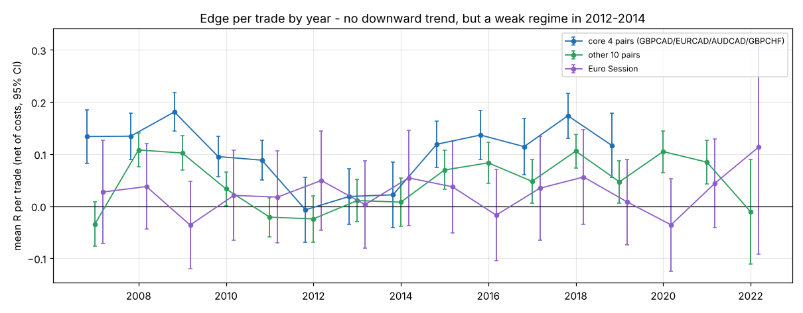
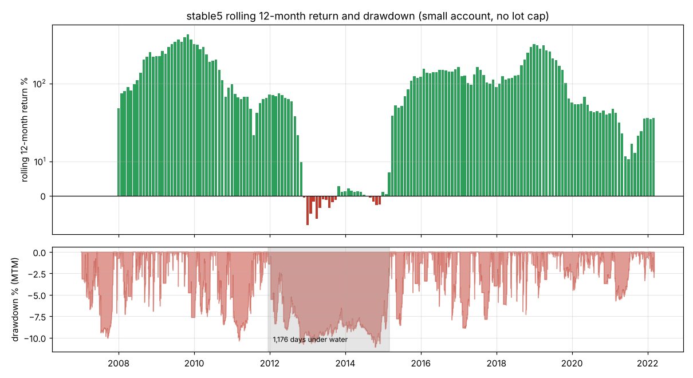
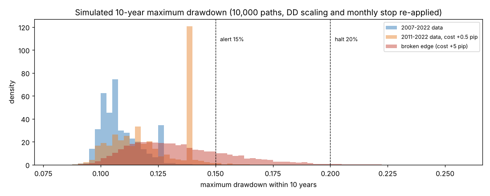

# GreatestTrader 長期運用評価報告書（v1.2 最終モデル）

バージョン 1.2.0 ／ 対象：既定プリセット **stable5**（売買ルールは v1.1 から変更なし）

---

## 1. 結論

| 観点 | 結果 |
|---|---|
| 優位性は劣化しているか | **劣化は見られません。** 中核 4 ペアの 1 取引あたりの利益（R）は 2007〜2019 年で傾き +0.0004R／年（95% 信頼区間 −0.0044〜+0.0051、p = 0.88）。その他のペアはむしろ改善傾向です |
| 弱点 | 優位性が数年単位で弱まる**「横ばい期」**があります。2012〜2014 年は中核ペアの平均 R がほぼ 0 で、資産が最高値を回復するまで **1,176 日**かかりました |
| 長期のドローダウン | 10 年間の模擬運用（1 万通り）で、最大 DD が 20% を超える確率は **0.0%**（コスト +0.5 pips の厳しい条件でも 0.0%）。DD 連動の縮小が効くためです |
| 長期の期待月利（複利） | 10 年の中央値で **月 5.1%**（2007〜2022 年のデータ）、**3.8%**（2011〜2022 年）、**1.8%**（2011〜2022 年、コスト +0.5 pips）。過去 15 年の 5.38% はやや恵まれた期間を含みます |
| 口座規模の上限（容量） | 深夜の薄商いで注文するため、口座が大きくなると注文が市場を動かします。**1 注文 20 ロットの上限を既定にしました。** 口座 約 6.6 万ドル（約 1,000 万円）までは影響がなく、それを超えると利益は「%」ではなく「金額」で頭打ちになります |
| 長期運用の弱点（改修済み） | MT5 の再起動後に再接続しない、週末の再起動で時計を誤判定する、入出金を損益として扱う、二重発注の可能性、1 通貨ペアの障害で全体が止まる、などを修正しました（7 章） |

**stable5 は引き続き既定・推奨のプリセットです。** 売買ルール・リスク率・保護機能は v1.1 のままで、v1.2 では「長く動かし続けるための仕組み」を追加しました。

---

## 2. 再評価の方法とデータの制約

- 使用データ：2007 年 1 月〜2022 年 3 月の 15 分足（v1.1 と同じ）。**中核 4 ペア（GBPCAD・EURCAD・AUDCAD・GBPCHF）は 2019 年 6 月まで**です。
- この作業環境からは新しい相場データを取得できませんでした（外部のデータ配信元に接続できないため）。そのため、**2022 年以降の成績はこの報告書では検証できていません。** その代わり、運用しながらご自身のブローカーのデータで再検証できる仕組み（8 章）を用意しました。
- 分析の内容：
  1. 年ごとの優位性（1 取引あたりの R）の推移と傾向の検定
  2. 12・24・36 か月ごとの成績のばらつき、最も長い含み損の期間
  3. 月次成績のブロック・ブートストラップによる 1・3・5・10 年の模擬運用（DD 連動の縮小と月次停止を再現。実際の成績との相関 0.998）
  4. 口座規模ごとの注文ロット数と、ロット上限を入れたバックテスト
  5. 安全装置（DD 停止・警告、優位性の監視）の誤報率と検出の速さ

---

## 3. 優位性は劣化しているか

| グループ | 1 取引の平均 R（2007〜2022） | 傾き（R／年） | 判定 |
|---|---|---|---|
| 中核 4 ペア | +0.105（t = 11.7） | +0.0004（95% CI −0.0044〜+0.0051） | 劣化なし |
| その他 10 ペア | +0.046（t = 6.2） | +0.0046（95% CI +0.0011〜+0.0080） | わずかに改善 |
| Euro Session | +0.021（t = 2.06） | 0.0000（95% CI −0.0049〜+0.0049） | 横ばい（もともと小さい） |

- 優位性は「少しずつ劣化」しているのではなく、**数年単位の局面で変わります**。中核ペアの平均 R は 2007〜09 年に 0.13〜0.18、2012〜14 年はほぼ 0、2015〜19 年に 0.11〜0.17 でした。
- 構造的な逆風は**コスト**です。値動き（ATR）が小さくなったため損切り幅が縮み（中核ペアで 2008 年の約 62 pips → 2017〜19 年の約 25 pips）、同じスプレッドでも R に換算したコストは約 2 倍（0.06R → 0.125R）になりました。取引あたりの利益（コスト控除前）も増えたため相殺されていますが、**コストが想定より 2 pips 高いと優位性はほぼ消えます**（平均 R 0.006）。
- データのある期間の最後（2019 年 7 月〜2022 年 2 月、中核ペアのデータなし）でも、その他のペアの平均 R は 0.081（t = 4.7）と、それ以前（0.040）より良好でした。

---

## 4. 期間ごとの安定性

| 期間の長さ | 損失になった期間の割合 | 最悪の期間 |
|---|---|---|
| 12 か月 | 9.4%（171 期間中 16） | −8.4%（2012 年 12 月まで） |
| 24 か月 | 6.3%（159 期間中 10） | −7.2%（2013 年 12 月まで） |
| 36 か月 | 2.0%（147 期間中 3） | −6.1%（2014 年 12 月まで） |

- 損失になった 12 か月の期間は、すべて 2012 年 11 月〜2013 年 9 月、2014 年 7 月〜11 月に終わる期間でした。
- 最も長い含み損の期間は **2011 年 12 月 15 日〜2015 年 3 月 5 日の 1,176 日**（最大 −11.1%）。この間、DD 連動の縮小により、2013 年は 66%、2014 年は 45% の日が最低倍率（0.1 倍）での取引でした。**DD が深くならない代わりに、回復に時間がかかる**のが stable5 の性質です。
- 2 番目に長い含み損の期間は 235 日で、それ以外は 160 日以内でした。

---

## 5. 長期の模擬運用（10 年）

月次成績を 3〜6 か月のまとまりで並べ替えて、1 万通りの 10 年間を作りました。DD 連動の縮小と月次停止は日次で再現しています。

| 前提 | 月利（複利）中央値 | 最大 DD 99% 点 | DD 15% 超の確率 | DD 20% 超の確率 | 損失の年が 1 回以上ある確率 | 24 か月新高値なしの確率 |
|---|---|---|---|---|---|---|
| 2007〜2022 年のデータ | 5.08% | 13.0% | 0.08% | 0.0% | 40% | 11% |
| 2011〜2022 年のデータ | 3.83% | 13.7% | 0.12% | 0.0% | 58% | 24% |
| 2007〜2022 年、コスト +0.5 pips | 3.19% | 14.5% | 0.47% | 0.0% | 69% | 33% |
| 2011〜2022 年、コスト +0.5 pips | 1.83% | 14.9% | 0.94% | 0.0% | 84% | 56% |
| 優位性が失われた場合（コスト +5 pips） | 0.08% | 19.7% | 22.6% | 0.74% | — | — |

- **DD 20% を超えることは、優位性が完全に失われた場合でもほとんどありません**（0.74%）。DD の大きさだけでは「優位性が失われた」ことを見分けられないため、取引の R を直接監視する仕組みを入れました（7.2 節）。
- 一方で、**10 年のうちに損失の年が 1 回以上ある確率は 40〜84%、2 年間最高値を更新できない確率は 11〜56%** です。横ばい期は「想定内」として運用を続けてください。

---

## 6. 口座規模と流動性（容量）

### 6.1 なぜ上限が必要か

v1.1 までのバックテストは、資産がいくら増えても同じ比率で注文する前提でした。そのため 1 万ドルから 15 年で 1 億 4,000 万ドルという、現実には不可能な数字になっていました（最大の注文は 19,624 ロット）。

- Night Reversion は 1 日で最も取引の少ない時間帯（日付変更直後）に注文します。この時間帯の取引量は、ロンドン・NY の重なる時間帯の約 18% です（主要通貨ペアのティック数で計測）。
- stable5 の中核ペアの 1 取引は、口座 1 万ドルあたり約 1.15 ロット（中央値）です。

| 口座（USD） | 中核ペアの 1 取引の目安（中央値） |
|---|---|
| 10,000 | 約 1.2 ロット |
| 66,000 | 約 7.6 ロット（大きい取引は 20 ロットに達する） |
| 173,000 | 約 20 ロット |
| 866,000 | 約 100 ロット |

### 6.2 上限ごとの成績（2007/01〜2022/03、初期資金 10,000 USD）

| 1 注文の上限 | 最終資産 | 月利（複利） | 最大 DD | 最悪月 | 上限が初めて効いた時点 |
|---|---|---|---|---|---|
| なし（理論値） | 1 億 3,982 万 | 5.38% | −11.6% | −4.75% | — |
| 100 ロット | 873 万 | 3.79% | −11.6% | −4.75% | 2011 年 9 月（資産 68 万） |
| 50 ロット | 495 万 | 3.47% | −11.6% | −4.75% | 2010 年 7 月（41 万） |
| **20 ロット（既定）** | **246 万** | **3.07%** | **−11.5%** | **−4.60%** | 2009 年 8 月（16 万） |
| 10 ロット | 149 万 | 2.78% | −11.1% | −3.70% | 2009 年 4 月（7.5 万） |

v1.2 の既定（20 ロット上限）で計算した各プリセットの成績（初期資金 10,000 USD、2007/01〜2022/03）：

| プリセット | 最終資産 | 月利（複利） | 最大 DD | 最悪月 |
|---|---|---|---|---|
| **stable5（既定）** | 246 万 | 3.07% | −11.5% | −4.60% |
| stable4 | 191 万 | 2.93% | −10.7% | −3.67% |
| safe2 | 37 万 | 2.00% | −11.7% | −2.00% |
| classic_conservative | 96 万 | 2.54% | −18.2% | −8.69% |
| classic_standard | 310 万 | 3.20% | −26.3% | −13.04% |
| classic_aggressive | 496 万 | 3.47% | −33.0% | −12.57% |

safe2 は 1 取引のリスクが小さいため、この期間では上限にほとんど達しません。

- 上限は、**大口の注文による不利な約定（マーケットインパクト）**を避けるためのものです。インパクトを 10 ロットあたり 0.25〜1.0 pips と仮定した試算では、20 ロットが最も損の少ない上限でした（最良の上限に対して最悪でも 81%）。ただし、この時間帯の実際の板の厚さは測定できておらず、推定です。
- 上限が効き始めると、利益は金額でほぼ一定になります（20 ロット上限で、2015〜2019 年は月 約 2.9 万ドル）。そのため、**月利（%）は資産が増えるほど下がります。**

| 口座（USD） | 20 ロット上限での期待月利の目安 |
|---|---|
| 25 万まで | 約 5%（上限の影響は小さい） |
| 50 万 | 約 3.3〜5.4% |
| 100 万 | 約 1.7〜4.8% |
| 200 万 | 約 0.8〜2.4% |
| 500 万 | 約 0.3〜1.0% |

（2010〜2019 年、2015〜2019 年、2018 年の平均から推定。円口座では 1 ドル 150 円として約 3,750 万円・7,500 万円・1.5 億円…に相当）

### 6.3 レバレッジ規制の影響

| 口座のレバレッジ | 月利（上限なし） | 月利（20 ロット上限） |
|---|---|---|
| 100 倍以上 | 5.38% | 3.07% |
| 50 倍 | 5.06% | — |
| 25 倍（国内） | 4.36% | 3.05% |
| 30 倍／20 倍（欧州の規制：主要通貨／その他） | 3.79% | — |

20 ロット上限のもとでは、国内口座（25 倍）でもほとんど差がありません（証拠金が足りなくなるのは資産 約 20 万ドルまでのため）。

---

## 7. 長期運用のための改修（v1.2）

### 7.1 安全装置（stable5 の値）

| 機能 | 内容 | 根拠 |
|---|---|---|
| 1 注文のロット上限（新規） | 1 注文 20 ロットまで（`max_lots_per_order` / InpMaxLotsPerOrder。0 で無効）。上限は保護機能の判定より先に適用し、合計リスク上限は上限後の実際のリスクで計算します。上限が効いたときはログと通知（1 日 1 回／通貨ペア） | 6 章 |
| 1 取引の最大リスク額（新規・任意） | 損切り時の損失額の上限（口座通貨、`max_risk_amount` / InpMaxRiskAmount。既定 0 = 無効）。例：円口座で 300,000 | 個人の損失許容額の設定用 |
| 最大 DD 停止 | **40% → 20%**（stable5・stable4・safe2）。到達すると新規エントリーを停止し、手動で解除 | 40% は過去・模擬運用・優位性喪失のどの場合も到達しないため、意味がありませんでした。20% は通常の運用では到達せず（10 年模擬 0.0%）、窓開け・不具合・ブローカーの異常など「統計の外」の事態だけを止めます |
| DD 警告（新規） | DD 15% 以上で通知（1 日 1 回まで。取引は変えない） | 10 年模擬で 15% を超える確率は 0.08〜0.94%。超えたら原因を確認する合図 |
| 優位性モニター（新規、Python 版） | 直近 250 取引の R（損益 ÷ リスク額）をリスクの重みで平均し、月末にマイナスなら **WARN**、2 か月連続なら **REVIEW** を通知。取引は自動では止めません | 下表 |
| 日次サマリー（新規） | 毎日、資産・DD・月初来の成績（入出金を除く）・取引数・停止状態を通知 | 無人運用の生存確認 |
| 死活監視（新規、Python 版・任意） | `notify.healthcheck_url`（例：healthchecks.io）に 5 分ごとに通知。止まると外部サービスから連絡が来ます | VPS 停止・異常終了の検知 |

**優位性モニターの過去の動作（2007〜2022 年）**

| ルール | 警告が出ていた月の割合 | 優位性が 0 になったときに検出するまで | 優位性が半分になったときに検出するまで |
|---|---|---|---|
| WARN（月末に 1 回） | 9.9%（2012〜14 年以外では 4.1%） | 中央値 4 か月（12 か月以内に 88%） | 中央値 8 か月 |
| REVIEW（2 か月連続） | 6.0%（2012〜14 年以外では 1.4%） | 中央値 5 か月（12 か月以内に 80%） | — |
| 参考：12 か月の成績がマイナス | 8.8% | 中央値 12 か月（12 か月以内に 54%） | 中央値 24 か月 |
| 参考：24 か月最高値を更新しない | 8.2% | 中央値 26 か月 | 中央値 36 か月 |

- 資産の増減ではなく取引の R を見るため、DD 連動の縮小で取引が小さくなっていても、優位性の変化を数か月で検出できます。
- 警告が出ても自動では止めません。過去の 2011 年 3 月・2021 年 3 月の警告の後は、6 か月で +37.5%・+18.0% と回復しており、自動停止は損でした。REVIEW が出たら、実際のコストの確認と最新データでの再検証（8 章）を行ってください。

### 7.2 入金・出金の扱い（新規）

MT5 の取引履歴から入金・出金・クレジット・ボーナスを検出し、最高資産・日次／月初の基準資産を同じ比率で調整します（既に処理した取引番号を記録して二重に数えません。初回起動時は過去の入出金を処理済みとして扱います）。

| 例（stable5、2007〜2022 年） | v1.1 まで | v1.2 |
|---|---|---|
| 毎月 10 日に資産の 3% を出金 | 月利（時間加重）0.22%、取引 2,693 回（月次停止が毎月発動） | 月利 5.38%、取引 13,838 回（出金なしと同じ） |
| 毎月 2% を入金 | 最大 DD −32.9%（入金で DD の記録が消えるため） | −11.6% |
| v1.1 の取扱説明書の回避策（出金後に状態ファイルを削除） | 最大 DD −31.2%、最悪月 −9.1% | 不要 |

### 7.3 時計（サーバー時間）の常時検証（新規）

- 起動時だけでなく、稼働中ずっと、最新のティックからブローカーのサーバー時間のずれ（GMT オフセット）を計測します。
- 自動判定（Python の `server_time_mode: auto`、EA の InpServerTime = AUTO。プリセットの既定）では、ずれが変わったことを 3 回続けて確認してから採用し、通知します。起動後、正しく計測できるまでは新規エントリーしません。週末に再起動しても、金曜日の古いティックで誤判定しません。
- 手動設定（ny7 / fixed）でも同じ検証を行い、3 回続けて食い違うと新規エントリーを止めて通知します。
- 時計を誤ると成績は大きく崩れます（stable5 2007〜2022 年の再計算：欧州型夏時間のブローカーで NY7 設定のまま 5.04%、固定 GMT+2 のブローカーで 2.18%・DD −16.5%、GMT+0 のブローカーで −0.18%・DD −40.2%）。

### 7.4 無人運用の信頼性（新規・修正）

| 問題（v1.1） | v1.2 の対応 |
|---|---|
| MT5 ターミナルが再起動（自動更新など）すると、以後ずっと失敗し続ける（再接続しない、プロセスも終了しない） | 毎ループ接続を確認して自動で再接続。30 分以上回復しないときは重大通知を送って終了コード 3 で終了し、起動バッチが新しいプロセスで再起動 |
| ポジション取得の失敗を「ポジションなし」と誤認し、同じ通貨ペアで二重に建てる可能性 | 取得失敗はエラーとして扱い、その回の新規エントリーを行わない |
| 注文の応答が失われると再送して二重発注 | 再送前に、同じマジックナンバーの新しいポジションができていないかを確認 |
| 1 つの通貨ペアのデータ取得エラーで、他の全ペアと Euro Session も止まる | 通貨ペアごとにエラーを分離。使えない通貨ペアは通知して除外し、他は取引を継続 |
| 通知の送信先が応答しないと、決済が最大 50 秒遅れる | 通知は別スレッドで送信し、取引のループを止めない（同じ内容の通知は間隔を空ける） |
| 状態ファイルが壊れると起動と停止を 30 秒ごとに繰り返す | 書き込みを安全に行い（変更時のみ・ディスクへ確実に書き出し）、毎日バックアップ（14 世代）。壊れていたらバックアップから復元し、どれも読めなければ「停止状態」で起動して通知 |
| 口座を一時的に別口座に切り替えると、最大 DD 停止が誤って発動 | 状態ファイルに口座番号を記録し、違う口座では取引しない |
| 2 つのエンジンを同時に起動できてしまう | 二重起動を防止（EA もチャート 2 枚での二重起動を防止）。ドライランは別の状態ファイルを使用 |
| Windows のコマンド画面をクリックすると処理が止まる（簡易編集モード） | 本番起動時に簡易編集モードを無効化。画面への出力は警告以上のみ |
| 夜間のログの切り替えに失敗すると、以後のログが失われる。ログは 60 日で削除 | 日付ごとのファイルに追記し、名前の変更をしない方式に変更（800 日保存）。取引記録（journal）は削除しない |
| 最大 DD 停止の解除に状態ファイルの削除が必要（DD の記録も消える） | `7_reset_halt.bat`（`python main.py reset-halt`）／EA の InpResetHalt で、停止だけを解除 |
| 依存パッケージの版が固定されておらず、将来の再インストールで動かない可能性 | Python 3.13 と、テスト済みの版を固定した `requirements-lock.txt` でインストール |
| ネッティング口座（同じ通貨ペアのポジションが合算される口座）で誤動作 | 起動時にヘッジング口座であることを確認し、ネッティング口座では動かない |

EA（MQL5 版）も同じ考え方で修正しました：ログイン完了前に状態を変更しない、起動に失敗したときに保存済みの状態を上書きしない、状態をこまめにディスクへ書き出す（GlobalVariablesFlush）、注文の再試行と二重発注の防止、決済失敗時の間隔を空けた再試行、ターミナル・自動売買の許可・価格の更新停止の監視。

### 7.5 取引記録と成績レポート（新規、Python 版）

- `journal/trades_YYYY.csv`：すべての発注と決済を追記します（意図した価格・約定価格・ロット・リスク額・決済理由・損益・R など）。削除・切り替えはしません。
- `journal/equity_log.csv`：毎日の資産・残高・入出金を追記します。
- `6_report.bat`（`python main.py report`）：MT5 の口座履歴から、入出金を除いた月次成績（時間加重）、戦略別の損益、3・6・12 か月の成績、優位性モニターを計算し、バックテストの目安（12 か月成績の下位 5% 点 −1.6%、過去最悪 −8.4%）と比べて `backtest_output/live_report/` に出力します。

---

## 8. 運用中の再検証の手順

| 頻度 | すること | 目安・判断 |
|---|---|---|
| 毎日（自動） | 日次サマリーの通知を確認（週末は届かず、金曜日の分は月曜日の取引開始後に届きます） | 平日に通知が来ない → VPS・MT5・エンジンの停止を疑う（死活監視を設定していれば外部サービスからも連絡が来ます） |
| 毎月（5 分） | `6_report.bat` を実行 | 月の成績が −3% 前後で止まる月は年 1〜2 回あります（想定内）。12 か月の成績が −1.6% を下回ったら注意、−8.4%（過去最悪）を下回ったら再検証 |
| 優位性モニターの通知 | WARN：様子を見る。REVIEW：実際のコスト（スプレッド＋手数料＋滑り）と、最新データでの成績を確認 | コストが想定より 0.5 pips 以上高い場合は、口座の見直しか `atr_cost_mult` を上げる |
| DD 警告（15%） | 原因を確認（相場の急変・約定の異常・ブローカーの問題） | 過去の最大は 11.6%。15% は 10 年に 1% 未満の水準 |
| 最大 DD 停止（20%） | 原因を確認するまで再開しない。再開は `7_reset_halt.bat` | 通常の運用では到達しない水準です |
| 四半期 | 取引記録で平均コストと約定の滑りを確認 | 想定より 0.5 pips 以上悪い状態が続くなら口座を見直す |
| 年 1 回（年末年始の新規停止期間 12/20〜1/5 に） | `4_download_data.bat` で最新データを取得し `5_backtest.bat` で再検証。MT5 ストラテジーテスター（リアルティック）でも確認 | 直近 1〜2 年の成績が、本書の範囲（損失年は 10 年に 1 回以上ありうる）から大きく外れていないか |
| 運用開始前（必須） | 中核 4 ペアの 2019 年 7 月以降を、ご自身のブローカーのデータで確認 | 中核ペアは利益の約 76% を生み、本書ではこの期間を検証できていません |

**長期運用で想定しておくこと**

- 2 年以上、資産が最高値を更新しない期間があり得ます（10 年のうちに 11〜56%）。DD 連動の縮小でリスクが小さくなっている間は、回復にも時間がかかります。
- 損失の年は 10 年に 1 回以上あると考えてください（40〜84%）。
- 口座が約 6.6 万ドル（約 1,000 万円）を超えると、利益は % ではなく金額でほぼ一定になっていきます（6 章）。
- 入金・出金は自動で処理されます。止めずに行っても構いませんが、念のため取引時間外（日本時間の昼間など）に行ってください。

---

## 9. 既知の限界

1. **2022 年 3 月以降、中核ペアは 2019 年 7 月以降のデータで検証できていません。** 中核 4 ペアは利益の約 76% を生みます。本来のリスクで運用する前に、ご自身のブローカーのデータで MT5 ストラテジーテスターによる確認を行ってください。
2. 20 ロットの上限は、深夜の板の厚さの推定に基づきます。ブローカーごとに実際の約定を確認し、必要なら調整してください（`max_lots_per_order` / InpMaxLotsPerOrder）。
3. 長期の模擬運用は過去の月次成績の並べ替えです。過去に起きていない種類の相場（例：長期の超低ボラティリティ、規制の変更）は含みません。
4. Euro Session は利益の約 2% と小さく、優位性を運用中に統計的に確かめるには約 3,900 取引（約 19 年）が必要です。
5. 過去の検証結果は将来の成績を保証しません。
